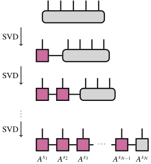
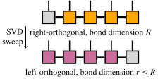

# TT-SVD Algorithm

The TT-SVD algorithm\cite{Oseledets:2011} decomposes a tensor into
[[matrix product state (MPS) or tensor train (TT)|mps]] form.
Starting from the full tensor, it applies the
[[singular value decomposition (SVD)|svd]]
repeatedly, splitting off one index at a time into its own MPS/TT tensor.
Discarding small singular values at each step compresses the result,
and the error this introduces is known exactly.

The TT-SVD algorithm is simple, and its accuracy is fully controlled, which makes it
a natural starting point for understanding MPS/TT decompositions.
But it needs the whole input tensor, so its cost grows exponentially with
the number of indices. It is only practical when the tensor fits in memory.
For tensors too large to store, one can use methods such as
[[tensor cross interpolation (TCI)|mps/algorithms/tci]], which only sample elements of the tensor.
If the input is already an MPS/TT with a large bond dimension, a
version of the same algorithm runs efficiently without ever forming the full tensor
(see [below](#rounding)).

<!--TOC-->

## Statement of the Problem

Given a tensor $T$ with $N$ indices $s_1, s_2, \ldots, s_N$, where index $s_j$ has dimension $d_j$,
we want an MPS/TT approximation

\begin{equation}
T^{s_1 s_2 \cdots s_N} \approx \sum_{\{\alpha\}} A^{s_1}_{\alpha_1} A^{s_2}_{\alpha_1 \alpha_2} \cdots A^{s_{N-1}}_{\alpha_{N-2} \alpha_{N-1}} A^{s_N}_{\alpha_{N-1}}
\end{equation}

where the bond (or "virtual") index $\alpha_k$ has dimension $r_k$, called the
bond dimension or TT rank. The goal is either the most accurate approximation
for given maximum ranks, or the smallest ranks that meet a target accuracy.
TT-SVD solves this problem approximately, with guarantees on the error given [below](#error).

## The Algorithm

TT-SVD sweeps from left to right. At each step it reshapes the current tensor into a matrix,
computes a truncated SVD, keeps the left factor $U$ as the next MPS/TT tensor,
and passes the rest, $SV^\dagger$, on to the next step.

### First Step

Begin with the full tensor and reshape it into a matrix $M^{(1)}$
whose row index is $s_1$ and whose column index groups all the remaining indices:

$M^{(1)}$ is a $d_1 \times (d_2 d_3 \cdots d_N)$ matrix. Computing its SVD gives

\begin{equation}
M^{(1)} = U^{(1)} S^{(1)} V^{(1)\dagger}
\end{equation}

where $U^{(1)}$ and $V^{(1)}$ have orthonormal columns and $S^{(1)}$ is diagonal and holds the
singular values $\sigma_1 \geq \sigma_2 \geq \ldots \geq 0$. 

To compress, keep only the $r_1$ largest singular values, together with the matching columns of $U^{(1)}$
and rows of $V^{(1)\dagger}$. A common way to choose $r_1$ is

- a maximum allowed rank $r$, or
- a tolerance $\delta$: take the smallest $r_1$ such that the discarded weight
  $\epsilon_1^2 = \sum_{j > r_1} \sigma_j^2$ satisfies $\epsilon_1 \leq \delta$,

or both together.

The truncated $U^{(1)}$ becomes the first MPS/TT tensor, $A^{s_1}_{\alpha_1} = U^{(1)}_{s_1, \alpha_1}$,
and the product of the other two factors becomes the remainder

\begin{equation}
\tilde{T}^{(2)}_{\alpha_1 s_2 s_3 \cdots s_N} = \sum_{\alpha'_1} S^{(1)}_{\alpha_1 \alpha'_1} V^{(1)\dagger}_{\alpha'_1, (s_2 s_3 \cdots s_N)}
\end{equation}

Because $S^{(1)}$ is diagonal, forming $\tilde{T}^{(2)}$ just scales each row of $V^{(1)\dagger}$.

### Subsequent Steps

At step $k$, reshape the remainder $\tilde{T}^{(k)}$ into the matrix $M^{(k)}_{(\alpha_{k-1} s_k),(s_{k+1} \cdots s_N)}$,
of size $(r_{k-1} d_k) \times (d_{k+1} \cdots d_N)$, and repeat:

1. Compute the SVD $M^{(k)} = U^{(k)} S^{(k)} V^{(k)\dagger}$.
2. Truncate to $r_k$ singular values. Call the discarded weight $\epsilon_k^2$.
3. Reshape $U^{(k)}$ into the tensor $A^{s_k}_{\alpha_{k-1} \alpha_k}$.
4. Form the next remainder $\tilde{T}^{(k+1)} = S^{(k)} V^{(k)\dagger}$.

### Last Tensor

After $N-1$ SVDs, the remainder $\tilde{T}^{(N)}$ has just the indices $\alpha_{N-1}$ and $s_N$.
No further SVD is needed: it becomes the last tensor $A^{s_N}_{\alpha_{N-1}}$.
Since all the other tensors are isometries, this last tensor carries the entire norm of the approximation,
$\|\tilde{T}\|_F = \|A^{s_N}\|_F$.

## Summary in Diagrams

Each SVD splits off one more index into an isometric MPS/TT tensor (pink),
and the remaining tensor (gray) shrinks by one index:

The result is an MPS/TT in _left-orthogonal_ (left-canonical) form, with its
[[orthogonality center|mps/index#gauges]] on the last tensor.

## Properties of the Resulting MPS/TT

Each tensor $A^{s_k}$ except the last comes from the left singular vectors $U^{(k)}$, which have orthonormal columns.
So it satisfies the left-orthogonality condition

\begin{equation}
\sum_{\alpha_{k-1}, s_k} \overline{A^{s_k}_{\alpha_{k-1} \alpha'_k}} A^{s_k}_{\alpha_{k-1} \alpha_k} = \delta_{\alpha'_k \alpha_k}
\end{equation}

or in diagram form:

This property makes many later computations cheap and numerically stable,
such as computing norms and expectation values, or further compression.

## Ranks and Exactness

If only zero singular values are discarded, TT-SVD is exact: contracting the resulting MPS/TT gives back $T$ exactly.
The $k$-th SVD then acts on a matrix with the same nonzero singular values as
the $k$-th _unfolding_ of $T$,

\begin{equation}
T_{(s_1 \cdots s_k),(s_{k+1} \cdots s_N)} ,
\end{equation}

the matrix formed by grouping the first $k$ indices into rows and the remaining indices into columns.
(This is because, without truncation, the earlier steps only changed the basis
for the row index of this unfolding, without discarding anything.)
Without truncation the ranks are therefore

\begin{equation}
r_k = \operatorname{rank} T_{(s_1 \cdots s_k),(s_{k+1} \cdots s_N)} \leq \min\Big( \prod_{j \leq k} d_j ,\ \prod_{j > k} d_j \Big)
\end{equation}

and no MPS/TT representing $T$ exactly can have a smaller rank on any bond.\cite{Oseledets:2011}
For a generic tensor with all $d_j = d$, the bound is reached, so the ranks grow
exponentially toward the middle of the chain, up to about $d^{N/2}$.

How compressible a tensor is depends on how fast the singular values of its unfoldings decay.
If they decay quickly, the ranks can be cut to small values with little error.
In quantum physics, where $T$ is the wavefunction of an $N$-site system, the singular values of the
unfolding at bond $k$ are the
[Schmidt coefficients](https://en.wikipedia.org/wiki/Schmidt_decomposition) between sites $1,\ldots,k$ and
$k+1,\ldots,N$. Fast decay corresponds to low entanglement across that bond, which is why
ground states of gapped, one-dimensional local Hamiltonians are well approximated by [[MPS|mps]].

## Error Analysis

Truncation errors in TT-SVD are easy to account for. Let $\epsilon_k^2$ be the sum of the squared singular values
discarded at step $k$. Each step discards a component that is orthogonal to everything kept,
and the isometries applied afterwards preserve this orthogonality. So the errors add in
quadrature _exactly_:

\begin{equation}
\|T - \tilde{T}\|_F^2 = \sum_{k=1}^{N-1} \epsilon_k^2
\end{equation}

where $\tilde{T}$ is the contracted MPS/TT and $\|\cdot\|_F$ is the Frobenius norm.
Each $\epsilon_k$ is at most $\eta_k$, the error of the best rank-$r_k$ approximation
to the $k$-th unfolding of $T$, so that
$\|T - \tilde{T}\|_F^2 \leq \sum_k \eta_k^2$.\cite{Oseledets:2011}
Since every MPS/TT with ranks $r_k$ has an error of at least $\eta_k$ for each $k$, this gives the
quasi-optimality result

\begin{equation}
\|T - \tilde{T}\|_F \leq \sqrt{N-1} \ \min_{X \text{ with ranks } r_k} \|T - X\|_F .
\end{equation}

The algorithm can thus be off from the best possible MPS/TT with the same ranks
by at most a factor $\sqrt{N-1}$.

The error formula also tells us how to reach a target accuracy. To guarantee a relative error
$\|T - \tilde{T}\|_F \leq \tau \|T\|_F$, truncate at each step with tolerance

\begin{equation}
\delta = \frac{\tau}{\sqrt{N-1}} \|T\|_F .
\end{equation}

## Computational Cost

Consider the case $d_j = d$ for all $j$, with ranks capped at $r$. Step $k$ factors an
$(r_{k-1} d) \times d^{N-k}$ matrix, at cost $O(r_{k-1}^2 d^{N-k+2})$ when the matrix has fewer rows than columns,
where the rank entering the step obeys
$r_{k-1} \leq \min(r, d^{k-1})$. For example, $r_1 \leq d$ always, since the first matrix has only $d$ rows.

While the ranks are still growing, $r_{k-1} = d^{k-1}$ and the cost of each step is $d$ times larger than the one before.
Once the ranks reach the cap $r$, each step costs $d$ times less than the one before.
The most expensive step is therefore the one where the rank first reaches $r$, and the total cost is

\begin{equation}
O\big(r\, d^{N+1}\big)
\end{equation}

for $r$ well below $d^{N/2}$. Storing the input already takes $O(d^N)$ memory, and every element of $T$ must be read
at least once, so this exponential scaling cannot be avoided when the input is a full tensor.
Without any truncation, the ranks grow all the way to $d^{N/2}$ and the cost is dominated by
the unfoldings near the middle of the chain, which are about $d^{N/2} \times d^{N/2}$, at a cost of $O(d^{3N/2})$.

When the ranks are much smaller than the unfolding dimensions, the full SVDs can be replaced by truncated
or randomized SVDs that compute only the leading $r$ singular vectors. This reduces the cost of each step,
including the most expensive one, to at most about $O(r\, d^N)$.

## TT-SVD of an Existing MPS/TT (TT-Rounding)

A common situation is that $T$ is already given as an MPS/TT, but with a larger bond dimension $R$ than needed.
This happens, for example, after adding two MPS/TT or multiplying one by an [[MPO|mpo]].
Contracting such a network into a full tensor would waste the structure it already has. Instead,
the same SVD sweep can be done directly on the MPS/TT tensors,
an algorithm known as TT-rounding\cite{Oseledets:2011} or SVD compression:\cite{Schollwoeck:2011}

1. Bring the MPS/TT into right-orthogonal form, using a sweep of QR decompositions from right to left.
   Now every tensor except the first is an isometry when viewed from the right.
2. Sweep from left to right. At each site, compute an SVD of the current tensor, grouping the
   left bond and site indices as rows, and truncate it. Keep $U$ as the new tensor, and multiply $SV^\dagger$ into the next tensor.

Because everything to the right of the current site is an isometry, each local SVD has exactly
the same singular values as the corresponding step of TT-SVD on the full tensor.
TT-rounding therefore gives the same result (up to gauge freedom, such as the signs of singular vectors),
with the same error formula, at a cost of only $O(N d R^3)$.

The same compression can also be done by the
[[density matrix algorithm|mps/index#compression]].
When multiplying an MPS/TT by an MPO, the [[density matrix|mps/algorithms/denmat_mpo_mps]] algorithm
performs this optimal truncation together with the multiplication, while the
[[zip-up|mps/algorithms/zip_up_mpo]] algorithm uses a closely related SVD sweep
that skips the orthogonalization step, so it is cheaper but only approximately optimal.

## Variants

**Right-to-left decomposition**: The sweep can equally go from the last index to the first,
producing a right-orthogonal MPS/TT with the norm in the first tensor.

**Adaptive truncation**: Because the errors add exactly, one can keep a running total of the discarded weight
and give the remaining error budget to the later steps. This often keeps smaller ranks than a
uniform tolerance $\delta$ while still meeting the same overall accuracy.

**Randomized TT-SVD**: Using randomized SVDs at each step lowers the cost when the ranks are small
compared with the unfolding dimensions, at the price of a small, controllable chance of extra error.

## Implementations

- [ITensorMPS.jl](https://github.com/ITensor/ITensorMPS.jl) (Julia):
  `MPS(A, sites; cutoff, maxdim)` decomposes a full ITensor `A` into an MPS, and `truncate!` performs
  TT-rounding of an existing MPS
- [TT-Toolbox](https://github.com/oseledets/TT-Toolbox) (MATLAB) and [ttpy](https://github.com/oseledets/ttpy) (Python),
  by the algorithm's original author
- [TensorLy](https://tensorly.org) (Python): `tensorly.decomposition.tensor_train`

