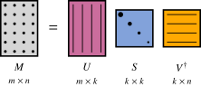
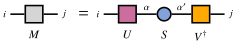
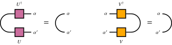
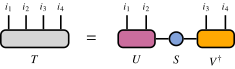
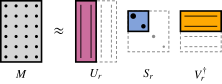

# Singular Value Decomposition (SVD)

The singular value decomposition (SVD) factorizes any matrix into a product of
two matrices with orthonormal columns and a diagonal matrix of non-negative numbers,
the singular values. It is one of the most important tools in tensor network methods:
it reveals the rank of a matrix and its most important directions,
it gives the best possible low-rank approximation of a matrix,
and, applied to a tensor whose indices have been split into two groups,
it factors the tensor into two pieces joined by a new bond index whose dimension can be controlled.
Algorithms such as [[TT-SVD|mps/algorithms/ttsvd]], [[DMRG|mps/algorithms/dmrg]],
and [[TRG|trg]] all rely on it.

<!--TOC-->

## Definition

Any $m \times n$ matrix $M$, real or complex, can be written as

\begin{equation}
M = U S V^\dagger , \qquad M_{ij} = \sum_{\alpha=1}^{k} U_{i\alpha}\, \sigma_\alpha\, \overline{V_{j\alpha}}
\end{equation}

where $k = \min(m,n)$ and

- $U$ is an $m \times k$ matrix with orthonormal columns, $U^\dagger U = I$,
- $V$ is an $n \times k$ matrix with orthonormal columns, $V^\dagger V = I$, and
- $S$ is a $k \times k$ diagonal matrix holding the _singular values_
  $\sigma_1 \geq \sigma_2 \geq \cdots \geq \sigma_k \geq 0$.

The columns of $U$ and $V$ are called the left and right _singular vectors_.
Schematically, for a matrix with more rows than columns:

Each dot in $M$ stands for an entry. The lines in $U$ and $V^\dagger$
stand for their orthonormal columns and rows, and $S$ is nonzero only on its diagonal,
with entries that decrease along the diagonal.

This is the _thin_ (or economy) SVD, which is the version used in tensor network codes.
The _full_ SVD instead extends $U$ and $V$ to square unitary matrices of size $m \times m$
and $n \times n$, and pads $S$ with zeros. The extra columns only multiply zeros,
so they add cost without adding any information.

Some basic properties of the SVD:

- The number of nonzero singular values equals the rank of $M$.
- The singular values are uniquely determined by $M$. A pair of singular vectors
  belonging to a nonzero, non-degenerate singular value is unique up to a common phase.
  For repeated singular values, any unitary rotation of the corresponding columns of $U$,
  together with the same rotation of the columns of $V$, gives another valid SVD.
- The squared singular values $\sigma_\alpha^2$ are the eigenvalues of both $M^\dagger M$ and $M M^\dagger$
  (the larger of the two also has extra zero eigenvalues).
  The columns of $V$ are eigenvectors of $M^\dagger M$, and the columns of $U$ are eigenvectors of $M M^\dagger$.
- The Frobenius norm is $\|M\|_F^2 = \sum_{ij} |M_{ij}|^2 = \sum_\alpha \sigma_\alpha^2$,
  and the spectral (operator) norm is $\|M\|_2 = \sigma_1$.
- For a Hermitian matrix with eigenvalues $\lambda_\alpha$, the singular values are the $|\lambda_\alpha|$.
  For a Hermitian positive semi-definite matrix, the SVD and the eigendecomposition coincide.

## Diagram Notation

In [[tensor diagram notation|diagrams]], the SVD of a matrix is drawn as

where the singular values form a diagonal matrix $S_{\alpha\alpha'} = \sigma_\alpha \delta_{\alpha\alpha'}$.
The orthonormality of the columns of $U$ and $V$ means that contracting either one with its
conjugate over the original index gives the identity:

Matrices with this property are called _isometries_. Note that the products in the other order,
$U U^\dagger$ and $V V^\dagger$, are generally not the identity.
They are projectors onto the spaces spanned by the columns of $U$ and $V$.

## SVD of a Tensor

To compute the SVD of a tensor, first choose which of its indices will go on each side of the factorization.
Grouping (reshaping) the first set of indices into a single row index and the rest into a single column index
turns the tensor into a matrix, which can be decomposed as above. Reshaping $U$ and $V^\dagger$
back gives tensors that carry the original indices:

The new index between $U$ and $V^\dagger$ has dimension at most the smaller of the
product of the dimensions of the indices on each side, here $\min(d_1 d_2, d_3 d_4)$
where $d_j$ is the dimension of index $i_j$.
Truncating it, as described below, compresses the tensor.
Repeating this step is how the [[TT-SVD algorithm|mps/algorithms/ttsvd]] turns a tensor
into a [[matrix product state / tensor train|mps]], and how [[DMRG|mps/algorithms/dmrg]]
splits an optimized two-site tensor back into MPS form.

In quantum physics, when $T$ is the wavefunction of a system split into two parts,
the SVD is known as the [Schmidt decomposition](https://en.wikipedia.org/wiki/Schmidt_decomposition).
The singular values are the Schmidt coefficients, and for a normalized state
the entanglement entropy between the two parts is
$S_\mathrm{E} = -\sum_\alpha \sigma_\alpha^2 \ln \sigma_\alpha^2$.

## Low-Rank Approximation

Keeping only the $r$ largest singular values, together with the matching columns of $U$ and $V$,
gives the _truncated SVD_

\begin{equation}
M_r = U_r S_r V_r^\dagger = \sum_{\alpha=1}^{r} \sigma_\alpha\, u_\alpha v_\alpha^\dagger
\end{equation}

where $u_\alpha$ and $v_\alpha$ are the columns of $U$ and $V$:

The matrix $M_r$ has rank (at most) $r$, and it is the best such approximation to $M$.
This is the Eckart--Young--Mirsky theorem:\cite{EckartYoung:1936,Mirsky:1960}
for any matrix $X$ of rank at most $r$,

\begin{align}
\|M - M_r\|_F &= \Big( \sum_{\alpha > r} \sigma_\alpha^2 \Big)^{1/2} \leq \|M - X\|_F \\
\|M - M_r\|_2 &= \sigma_{r+1} \leq \|M - X\|_2
\end{align}

More generally, $M_r$ is a best rank-$r$ approximation in every _unitarily invariant_ norm,
meaning any norm with $\|W M Z\| = \|M\|$ for all unitary $W$ and $Z$.\cite{Mirsky:1960}
Besides the Frobenius and spectral norms, this includes the nuclear norm $\sum_\alpha \sigma_\alpha$
and the other Schatten norms. In the Frobenius norm, the best approximation is unique
when $\sigma_r > \sigma_{r+1}$. If instead $\sigma_r = \sigma_{r+1} > 0$, there are many equally good choices.

This optimality is why the SVD is so central to tensor networks.
The Frobenius norm of a tensor does not depend on how its indices are grouped,
so a truncated SVD gives the best approximation of the tensor being factorized
for a given dimension of the new bond index.
When the rest of a network consists of isometries, as in an MPS in
[[canonical form|mps/index#gauges]] with its orthogonality center at the tensor being factorized,
the error of the whole network equals the error of this local truncation.
The truncation is then optimal for the whole network too,
and its error is given exactly by the discarded singular values.
Without such orthogonality, truncating one bond is still optimal for that tensor
but not, in general, for the full network.

The truncated SVD is _not_ optimal, in general, for norms that are not unitarily invariant,
such as the largest absolute error of any single entry,
or a weighted error $\sum_{ij} W_{ij} |M_{ij} - X_{ij}|^2$.
Finding the best low-rank approximation under such a weighted error
(which includes the case of missing entries) is NP-hard in general.\cite{GillisGlineur:2011}

## Truncation Strategies

In practice the number $r$ of singular values to keep is chosen by one or more of the following rules,
often combined, for example "keep at most $r_{\max}$, but fewer if the error target is already met":

- **Maximum rank**: keep at most $r_{\max}$ singular values.
  This fixes the cost and memory of the computations that follow,
  but gives no control over the error.
- **Relative tolerance**: keep the smallest $r$ such that the relative error in the Frobenius norm
  is at most $\tau$. By the theorem above, this error is known exactly from the discarded singular values:
  \begin{equation}
  \frac{\|M - M_r\|_F}{\|M\|_F} = \Big( \frac{\sum_{\alpha > r} \sigma_\alpha^2}{\sum_{\alpha} \sigma_\alpha^2} \Big)^{1/2} \leq \tau .
  \end{equation}
  This is the usual convention in numerical linear algebra, and it is how the accuracy of
  algorithms such as [[TT-SVD|mps/algorithms/ttsvd]] is often specified.
  An absolute version, $\|M - M_r\|_F \leq \delta$, is also used.
- **Truncation error (discarded weight)**: keep the smallest $r$ such that
  \begin{equation}
  \frac{\sum_{\alpha > r} \sigma_\alpha^2}{\sum_{\alpha} \sigma_\alpha^2} \leq \epsilon .
  \end{equation}
  This quantity is called the _truncation error_ or _discarded weight_ in the DMRG and tensor network literature.
  For a normalized quantum state, it is the total probability of the discarded states.
  It is the _square_ of the relative error above, so a cutoff $\epsilon$ is the same rule as a relative tolerance $\tau = \sqrt{\epsilon}$:
  \begin{equation}
  \frac{\|M - M_r\|_F}{\|M\|_F} \leq \sqrt{\epsilon} .
  \end{equation}
  For example, a cutoff of $\epsilon = 10^{-10}$ corresponds to a relative error of about $10^{-5}$.
  A cutoff on the truncation error is a common rule in tensor network codes, usually combined with a maximum rank.
  Note that in numerical analysis, "truncation error" usually refers to something else:
  the error from truncating a series or a discretization.
- **Singular value threshold**: discard every singular value below a threshold,
  either absolute ($\sigma_\alpha < \theta$) or relative ($\sigma_\alpha < \theta\, \sigma_1$).
  This controls the spectral-norm error and is the usual way to define a numerical rank
  or compute a pseudoinverse. It does not control the Frobenius-norm error,
  since many discarded singular values just below the threshold can add up.

Some further practical points:

- **Degenerate singular values**: cutting between two equal (or nearly equal) singular values
  is an arbitrary choice, and can break symmetries of the problem. It is common to either keep or
  discard such groups of singular values together.
- **Minimum rank**: iterative algorithms such as DMRG sometimes impose a minimum rank,
  so that the bond dimension cannot get stuck at an artificially small value early on.
- **Normalization**: truncation lowers the norm, $\|M_r\|_F^2 = \|M\|_F^2 - \sum_{\alpha>r}\sigma_\alpha^2$.
  When $M$ represents a normalized quantum state, the kept singular values are usually rescaled
  so that the state stays normalized.

## Computational Cost

For a dense $m \times n$ matrix with $m \geq n$, the thin SVD costs $O(m n^2)$ operations.
Standard algorithms first reduce the matrix to bidiagonal form using Householder reflections,\cite{GolubKahan:1965}
and then find the SVD of the bidiagonal matrix iteratively, by QR iteration or by a divide-and-conquer method.\cite{GolubVanLoan:2013}
The constant in front is noticeably larger than for a QR decomposition or a matrix multiplication of the same size.
Computing only the singular values, without the singular vectors, is cheaper.
The full SVD is more expensive, since $U$ then has size $m \times m$ instead of $m \times k$, which adds to both the work and the memory needed.

In tensor network algorithms the SVD is often one of the most expensive steps.
For example, splitting a two-site MPS tensor with bond dimension $\chi$ and site dimension $d$
requires the SVD of a $(\chi d) \times (d \chi)$ matrix, at a cost of $O(d^3 \chi^3)$.

When only the leading $r \ll \min(m,n)$ singular values are needed, there are cheaper options:

- **Iterative (Krylov) methods**, based on Lanczos bidiagonalization,
  only require multiplying vectors by $M$ and $M^\dagger$.
  For a dense matrix they cost roughly $O(m n r)$, with a prefactor that depends on how quickly they converge.
  They also work when $M$ is never stored,
  for example when it is given implicitly by a tensor network contraction.
- **Randomized SVD**\cite{Halko:2011} multiplies $M$ by a random $n \times (r+p)$ matrix,
  with a small oversampling $p$, to capture the dominant column space of $M$,
  and then computes an exact SVD of a small projected matrix.
  It costs about $O(m n r)$, needs only a few passes over $M$, and is accurate when the singular values decay quickly.

Other decompositions can sometimes take the place of an SVD:

- When no truncation is needed, a **QR decomposition** is cheaper and is enough to orthogonalize a tensor,
  for example when bringing an MPS into canonical form.
- **Diagonalizing** $M^\dagger M$ (as in the [[density matrix algorithm|mps/index#compression]]) gives the
  singular values and right singular vectors, and allows the same truncations.
  It has the same $O(m n^2)$ scaling, but can be faster in practice when $m \gg n$,
  since forming $M^\dagger M$ is a fast matrix multiplication.
  The drawback is that it squares the condition number: in double precision, singular values smaller than
  about $10^{-8}\, \sigma_1$ are lost to rounding errors.

## Software

- Julia: `svd` in the `LinearAlgebra` standard library (divide and conquer by default),
  and `svdsolve` in [KrylovKit.jl](https://github.com/Jutho/KrylovKit.jl) for a few leading singular values.
  [ITensors.jl](https://itensor.org) provides `svd(T, inds; maxdim, cutoff)` for tensors, with truncation.
- Python: `numpy.linalg.svd` and `scipy.linalg.svd` for dense matrices,
  and `scipy.sparse.linalg.svds` for a few leading singular values.
- [LAPACK](https://www.netlib.org/lapack/): the routines `gesvd` (QR iteration) and `gesdd` (divide and conquer),
  which most of the libraries above call internally.
